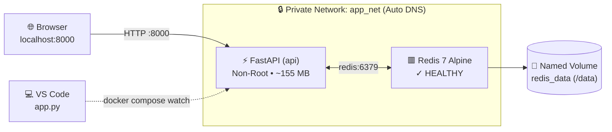

<div align="center">

# 🐳 Docker in 2026: Zero to Full-Stack

**Official Companion Repository • IEEE SIESGST Technical Series**

*Go from "It works on my machine!" to a hardened, multi-container **FastAPI + Redis** stack with persistent volumes, BuildKit caching, and live reload.*

[](https://www.docker.com/)
[](https://fastapi.tiangolo.com/)
[](https://redis.io/)
[](https://docs.docker.com/compose/)

<br />

[](https://codespaces.new/Shubham-Gotawade/sies-docker-demo)

*No Docker installed? Click the badge above to launch a free browser lab with VS Code, Docker Engine & Compose V2 pre-installed.*

</div>

---

## 🏗️ System Architecture



---

## ⚡ Quick Start (One Command)

```bash
git clone [https://github.com/Shubham-Gotawade/sies-docker-demo.git](https://github.com/Shubham-Gotawade/sies-docker-demo.git)
cd sies-docker-demo
docker compose up -d --build
```

Open **`http://localhost:8000`** — you will see:
- An emerald **`● Storage: Redis (Persistent Volume)`** badge
- Your live **`Container ID`** (powered by `socket.gethostname()`)
- Interactive Swagger docs at **`/docs`** and JSON telemetry at **`/health`**

---

## 📊 Part 1: Naive vs. Optimized Image Benchmark

Compare the two Dockerfiles side-by-side to see why layer ordering and multi-stage builds matter:

| Metric | `Dockerfile.naive` | `Dockerfile` (2026 Pro) | Improvement |
| :--- | :--- | :--- | :--- |
| **Base Image** | `python:3.12` (Full Debian) | `python:3.12-slim` (Multi-Stage) | Minimal attack surface |
| **Final Image Size** | `~1.05 GB` | `~155 MB` | **-85% smaller** |
| **Code-Edit Rebuild** | `~30s` (cache busted) | `~0.3s` (cached + BuildKit mount) | **~100× faster** |
| **Runtime Security** | `root` (UID 0) | `appuser` (Non-Root) | Production hardened |

```bash
# 1. Build bloated naive image
docker build -f Dockerfile.naive -t sies-app:naive .

# 2. Build optimized multi-stage image
docker build -t sies-app:pro .

# 3. Compare image sizes
docker images sies-app
```

---

## 💥 Part 2: The Volume Kill Test

Prove that **containers are ephemeral while named volumes survive**:

1. Open **`http://localhost:8000`**, submit 2 hackathon ideas, and note the **`Container ID`** in the top-right corner.
2. Destroy both containers and tear down the virtual network:
   ```bash
   docker compose down
   ```
3. Launch brand-new containers from scratch:
   ```bash
   docker compose up -d
   ```
4. Refresh the browser — you will see a **completely new Container ID**, while your **Page Hits and Ideas remain 100% intact**.

---

## 🔥 2026 Docker Workflow Commands

```bash
# Instant <1s code sync without manual rebuilds (Compose Watch)
docker compose watch

# Scan your production image for CVEs (Docker Scout)
docker scout quickview sies-app:pro

# Attach an ephemeral debug toolbox to a slim container
docker debug sies-docker-demo-api-1

# Run a local open-weights LLM via Docker Model Runner
docker model run ai/llama3.2 "Explain Docker volumes in one sentence."
```

---

## 🏆 The 5-Minute Student Challenge

1. Run `docker compose up -d --build` and complete the **Kill Test** above.
2. Start live reload with `docker compose watch`.
3. Add a custom key (e.g. `"author": "your-name"`) inside `/health` in `app.py`, hit **Save**, and verify `<1s` sync at **`http://localhost:8000/health`**.
4. Comment your final **`sies-app:pro` image size** and the next project you are Dockerizing under the YouTube video!

---

## 📁 Repository Structure

```text
sies-docker-demo/
├── .devcontainer/
│   └── devcontainer.json   # 1-click free GitHub Codespaces Docker lab
├── app.py                  # FastAPI backend + frosted dark-glass UI
├── requirements.txt        # Pinned Python dependencies
├── .dockerignore           # Blocks .git, .venv, .env & cache bloat
├── Dockerfile.naive        # Intentionally unoptimized (~1.05 GB, root)
├── Dockerfile              # Multi-stage + BuildKit cache + non-root (~155 MB)
└── compose.yaml            # Modern Compose V2 + healthcheck + watch
```

---

## 🧹 Cleanup

```bash
# Stop and remove containers + named volume + local demo images
docker compose down -v
docker rmi sies-app:naive sies-app:pro
```

<div align="center">

Built with 💙 for engineering students by **[IEEE SIESGST Technical Series](https://github.com/Shubham-Gotawade/sies-docker-demo)**

*Star ⭐ this repo if it saved you from a 3 AM hackathon meltdown!*

</div>
